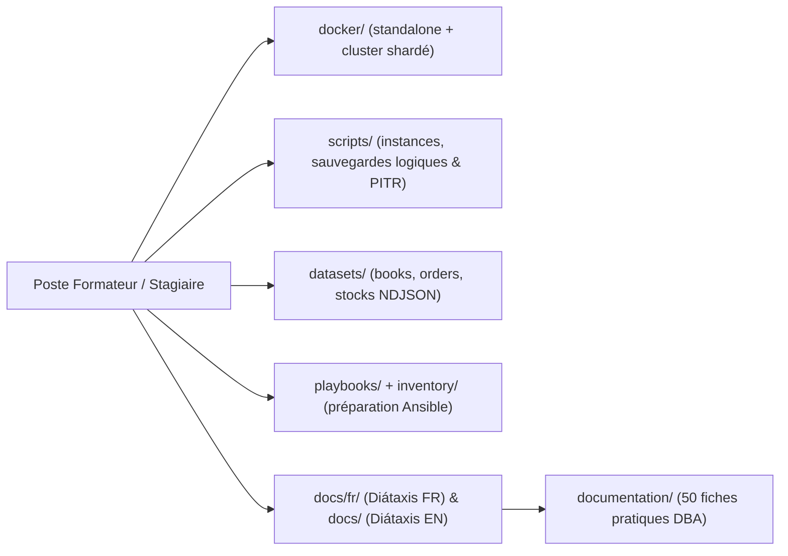

# mongodb-training (Documentation Française)

Dépôt pédagogique dédié à l'administration MongoDB : environnements Docker Compose standalone et shardés, scripts Bash d'exploitation et de sauvegarde/restauration, jeux de données NDJSON, playbooks Ansible et cours complets en français sous `documentation/` et `docs/fr/`.

> **Sélecteur de langue :** [English Version (README.md)](README.md) | [Portail Diátaxis FR (docs/fr/index.md)](docs/fr/index.md) | [English Docs Portal (docs/index.md)](docs/index.md)

## Architecture du Dépôt



## Inventaire des Composants

| Répertoire | Rôle | État vérifié |
| :--- | :--- | :--- |
| `docker/standalone/` | Stack Docker Compose `mongo` + `mongo-express` (`27017`, `8081`) | Valide (`docker compose config`) |
| `docker/sharded/` | Cluster shardé complet (3 config servers, 2 shards x3, 2 `mongos`, init) | Valide (`docker compose config --env-file .env_example`) |
| `scripts/` | 12 scripts d'instances, utilisateurs, alias et sauvegardes logiques | 11 valides (`create_mongos.sh:L230` tronqué en amont) |
| `scripts/backups_pitr/` | Scripts PITR `full` / `incremental` + [README.md](scripts/backups_pitr/README.md) | `bash -n` OK (copie quasi identique de `scripts/pitr_backup.sh`) |
| `datasets/` | Fichiers NDJSON (`books.json`, `orders.json`, `stocks.json`) et `import.sh` | `1 192` lignes JSON valides |
| `playbooks/` & `inventory/` | Playbooks Ansible et inventaire INI (`app`, `mongodb`, `proxy`) | 4 YAML valides (`config_system.yml:L181` erreur d'indentation) |
| `documentation/` | 50 fiches de cours et TP DBA en français | `10/10` diagrammes Mermaid compilent avec `mmdc` |
| `docs/fr/` & `docs/` | Portails Diátaxis structurés FR (ASD-STF100) et EN (ASD-STE100) | `0` erreur structurelle ou lexicale |
| `tests/` | Suite de tests exécutable (`test_docs_tutorials_howtos.py`) | Syntaxe shell, Compose, YAML, NDJSON, Diátaxis, Mermaid |

## Démarrage Rapide

```bash
# 1. Démarrer le laboratoire standalone MongoDB + mongo-express
docker compose -f docker/standalone/compose.yaml up -d

# 2. Valider la topologie Docker Compose shardée sans démarrer les conteneurs
docker compose --env-file docker/sharded/.env_example -f docker/sharded/docker-compose.yml config -q

# 3. Exécuter la suite de tests automatisés du dépôt
python3 -m unittest discover -s tests -p "test_*.py" -v
```

> **Avertissement de sécurité :** Les identifiants d'exemple présents dans `docker/standalone/compose.yaml` (`root`/`admin1`), `docker/sharded/.env_example` (`SuperSecurePassword123`), `init-replica-sets.js`, `init-users.js` et `scripts/create_admin_user.sh` (`admin`/`admin`) sont publics dans Git. Changez chaque secret hors poste de laboratoire isolé.

## Parcours Documentaires

- **Portail Diátaxis Français :** [docs/fr/index.md](docs/fr/index.md) ([Tutoriels](docs/fr/01-tutoriels/index.md), [Guides pratiques](docs/fr/02-guides-pratiques/index.md), [Référence](docs/fr/03-reference/index.md), [Explications](docs/fr/04-explications/index.md))
- **Portail Diátaxis Anglais :** [docs/index.md](docs/index.md)
- **Fiches historiques (`documentation/`) :** Voir les dossiers thématiques `installation/`, `configuration/`, `replica-set/`, `shard-cluster/`, `sauvegarde-resturation/`, `performance/`, `supervision/` et `utilisateurs/`.
