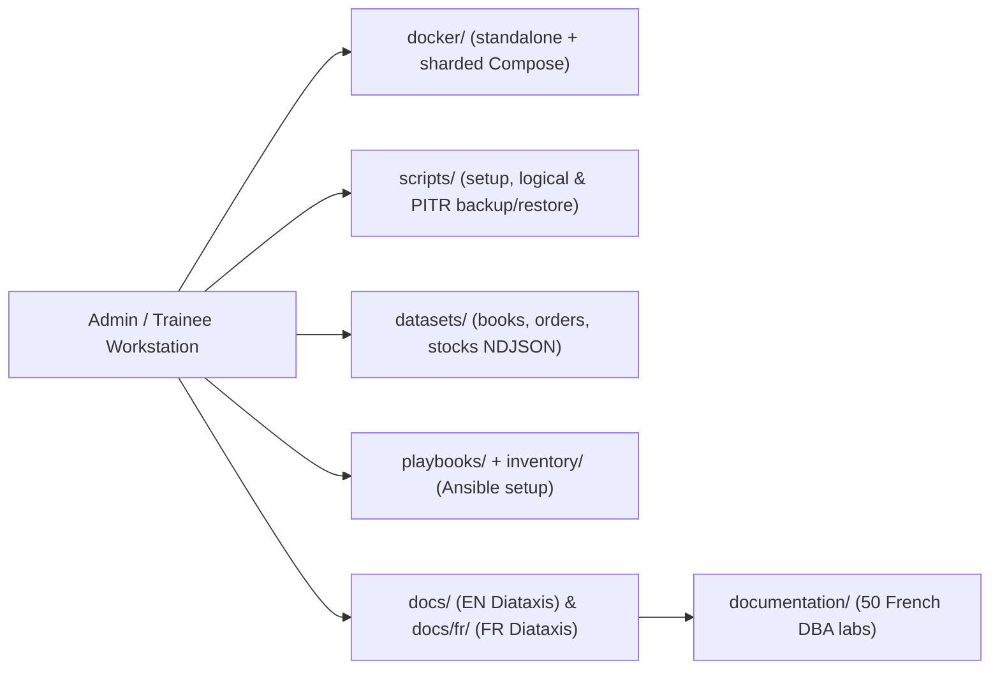

# mongodb-training

Hands-on MongoDB administration, Docker Compose topologies, Bash automation scripts, sample NDJSON datasets, Ansible playbooks, and bilingual documentation (**English** root + Diataxis portal, **French** training curriculum under `documentation/` and `docs/fr/`).

> **Language switcher:** [Version française (README.fr.md)](README.fr.md) | [English Docs Portal (docs/index.md)](docs/index.md) | [Portail FR (docs/fr/index.md)](docs/fr/index.md)

## Repository Architecture



## Components Overview

| Path | Role | Verification Status |
| :--- | :--- | :--- |
| `docker/standalone/` | Minimal MongoDB + `mongo-express` Compose stack (`27017`, `8081`) | Valid `docker compose config` |
| `docker/sharded/` | 3-configsvr + 2x3-shard + 2-`mongos` + setup Compose cluster | Valid `docker compose config --env-file .env_example` |
| `scripts/` | 12 instance, user, alias, backup, and dataset Bash scripts | 11 pass `bash -n` (`create_mongos.sh:L230` truncated upstream) |
| `scripts/backups_pitr/` | Oplog-based `full`/`incremental` PITR scripts + [README.md](scripts/backups_pitr/README.md) | Pass `bash -n`; 2-line comment copy of `scripts/pitr_backup.sh` |
| `datasets/` | Line-delimited NDJSON files (`books.json`, `orders.json`, `stocks.json`) + `import.sh` | All `1,192` NDJSON lines parse cleanly |
| `playbooks/` & `inventory/` | Ansible VM prep playbooks and static INI inventory | 4 playbooks valid YAML (`config_system.yml:L181` indent bug) |
| `documentation/` | 50 French-language DBA lessons, labs, and diagrams | `10/10` Mermaid blocks compile via `mmdc` |
| `docs/` & `docs/fr/` | Diataxis documentation suites in English and French | Strict ASD-STE100 / ASD-STF100 (`0` errors) |
| `tests/` | Executable `unittest` suite (`test_docs_tutorials_howtos.py`) | Shell, Compose, YAML, NDJSON, Diataxis, Mermaid |

## Quickstart

```bash
# 1. Start the standalone MongoDB + mongo-express lab
docker compose -f docker/standalone/compose.yaml up -d

# 2. Validate the sharded Docker Compose topology offline
docker compose --env-file docker/sharded/.env_example -f docker/sharded/docker-compose.yml config -q

# 3. Run the automated documentation and configuration verification suite
python3 -m unittest discover -s tests -p "test_*.py" -v
```

> **Security Warning:** Default credentials inside `docker/standalone/compose.yaml` (`root`/`admin1`), `docker/sharded/.env_example` (`SuperSecurePassword123`), `init-replica-sets.js`, `init-users.js`, and `scripts/create_admin_user.sh` (`admin`/`admin`) are public training values. Rotate all passwords before exposing containers on shared networks.

## Documentation Portals

- **English Diataxis Portal:** [docs/index.md](docs/index.md) ([Tutorials](docs/01-tutorials/index.md), [How-To Guides](docs/02-how-to-guides/index.md), [Reference](docs/03-reference/index.md), [Explanation](docs/04-explanation/index.md))
- **French Diataxis Portal:** [docs/fr/index.md](docs/fr/index.md) ([Tutoriels](docs/fr/01-tutoriels/index.md), [Guides pratiques](docs/fr/02-guides-pratiques/index.md), [Référence](docs/fr/03-reference/index.md), [Explications](docs/fr/04-explications/index.md))
- **French Training Curriculum:** See `documentation/` subdirectories and [README.fr.md](README.fr.md).
