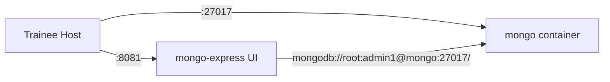

# Tutorial 1: Standalone Docker Lab and NDJSON Dataset Import

In this tutorial, you validate and launch the standalone MongoDB Docker stack (`docker/standalone/compose.yaml`), inspect the web UI (`mongo-express`), and verify the NDJSON sample collections under `datasets/`.

## Prerequisites

- Docker Engine with `docker compose` plugin installed.
- Python 3 (for validating NDJSON records offline before import).

## Step 1: Validate the Standalone Compose Definition

Inspect `docker/standalone/compose.yaml` before launching containers:

```bash
docker compose -f docker/standalone/compose.yaml config -q
```



> **Training Security Note**: `docker/standalone/compose.yaml` sets `MONGO_INITDB_ROOT_USERNAME: root` and `MONGO_INITDB_ROOT_PASSWORD: admin1`. Use these defaults only inside isolated local lab environments.

## Step 2: Launch MongoDB and Verify Container Health

Start the services in the background and confirm both containers are active:

```bash
docker compose -f docker/standalone/compose.yaml up -d
docker compose -f docker/standalone/compose.yaml ps
```

Verify database connectivity through `mongosh` inside the `mongo` container:

```bash
docker compose -f docker/standalone/compose.yaml exec mongo mongosh -u root -p admin1 --authenticationDatabase admin --eval "db.adminCommand({ ping: 1 })"
```

Expected JSON response fragment:

```text
{ ok: 1 }
```

## Step 3: Validate and Import Sample NDJSON Datasets

`datasets/` stores three line-delimited NDJSON files (`books.json`: 150 lines, `orders.json`: 1,000 lines, `stocks.json`: 42 lines) plus `datasets/import.sh`. Verify every line parses cleanly as JSON first:

```bash
python3 -c "import json, pathlib; [json.loads(line) for f in sorted(pathlib.Path('datasets').glob('*.json')) for line in f.read_text(encoding='utf-8').splitlines() if line.strip()]; print('All 3 NDJSON datasets valid')"
```

Import `books.json` into the running standalone container using `mongoimport`:

```bash
docker compose -f docker/standalone/compose.yaml exec -T mongo mongoimport -u root -p admin1 --authenticationDatabase admin --db training --collection books --drop < datasets/books.json
```

## Step 4: Clean Up the Sandbox

Stop and remove the standalone lab containers and default network:

```bash
docker compose -f docker/standalone/compose.yaml down
```

## Next Steps

- Continue to [Tutorial 2: Sharded Docker Cluster Validation and Backup Workflows](02-sharded-docker-cluster-and-backups.md).
- Follow operational runbooks in [How-To Guides](../02-how-to-guides/index.md).
- Inspect all component details in [Reference](../03-reference/scripts-compose-and-known-issues.md).
