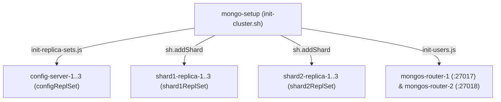

# Tutorial 2: Sharded Docker Cluster Validation and Backup Workflows

In this tutorial, you validate the 12-container sharded MongoDB topology (`docker/sharded/`), trace cluster initialization (`init-scripts/`), and inspect the syntax of logical and PITR backup scripts.

## Prerequisites

- Docker Engine with `docker compose` (`v2`) installed.
- Bash shell (`bash -n`) for syntax checks.

## Step 1: Validate the Sharded Compose Stack Offline

`docker/sharded/docker-compose.yml` expects variables from `docker/sharded/.env_example` (`MONGO_VERSION=7.0`, `MONGO_NETWORK=mongodb-sharded-network`, and port bindings `27017`–`27027`). Validate configuration rendering without starting containers:

```bash
docker compose --env-file docker/sharded/.env_example -f docker/sharded/docker-compose.yml config -q
```



## Step 2: Inspect Initialization Scripts and Keyfile Preparation

Before booting the sharded cluster on Linux hosts, host directories and the internal replica-set keyfile are prepared using `init-datadir.sh` and `init-keyfile.sh`:

```bash
bash -n docker/sharded/init-scripts/init-datadir.sh
bash -n docker/sharded/init-scripts/init-keyfile.sh
bash -n docker/sharded/init-scripts/init-cluster.sh
```

Inspect `docker/sharded/init-scripts/init-replica-sets.js` and `init-users.js` carefully: those JavaScript files contain hardcoded training credentials (`root` / `SuperSecurePassword123`, `admin` / `AdminPassword123`, `superadmin` / `SuperAdminPassword123`) matching `docker/sharded/.env_example`.

## Step 3: Validate Logical and PITR Backup Scripts Safely

The repository provides two backup tracks under `scripts/`:

- **Logical archives**: `scripts/logical_backup.sh` (`mongodump` + optional `--oplog` + `tar.gz` + `sha256sum` + optional OpenSSL encryption) and `scripts/logical_restore.sh`.
- **Oplog PITR directories**: `scripts/backups_pitr/mongo_backup.sh` (`full` and `incremental` modes) and `scripts/backups_pitr/mongo_restore.sh`.

Run Bash syntax verification across both backup tracks from the repository root:

```bash
bash -n scripts/logical_backup.sh scripts/logical_restore.sh scripts/backups_pitr/mongo_backup.sh scripts/backups_pitr/mongo_restore.sh
```

Expected output: exit code `0` with no stderr diagnostics.

> **Known Script Order Note**: Line `26` of `scripts/logical_backup.sh` executes `exec > >(tee -a "${LOG_FILE}") 2>&1` before `mkdir -p "${BACKUP_BASE_DIR}"` on line `35`. Pre-create `/var/backups/mongodb` before running `logical_backup.sh` on a fresh host.

## Next Steps

- Execute operational procedures in [How to Execute Logical and PITR Backups](../02-how-to-guides/execute-logical-and-pitr-backups.md).
- Read design comparisons in [Topology and Backup Architecture](../04-explanation/topology-and-backup-architecture.md).
- Review all script parameters and upstream defects in [Reference](../03-reference/scripts-compose-and-known-issues.md).
