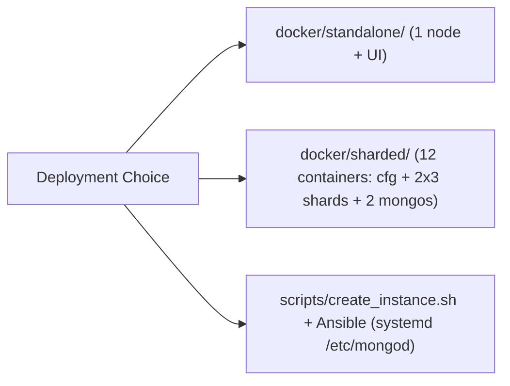

# Topology and Backup Architecture

**mongodb-training** pairs containerized topologies (`docker/standalone/` and `docker/sharded/`) with host-level `systemd` provisioning and dual backup mechanisms under `scripts/`. Understanding why each track exists avoids mixing incompatible deployment assumptions during labs.

## Deployment Topologies Comparison

| Dimension | `docker/standalone/` | `docker/sharded/` | Host `scripts/` + `playbooks/` |
| :--- | :--- | :--- | :--- |
| **Target use** | CRUD exercises, `mongosh`, `mongoimport` | Cluster routing, shard keys, replica-set elections | Production-like multi-service OS administration |
| **Footprint** | `2` containers (`mongo`, `mongo-express`) | `11` persistent containers + `mongo-setup` | `mongodb@.service` per `instance<N>` (`27016 + N`) |
| **Authentication** | Single root user (`admin1`) | Shared `keyFile` across shards + `init-users.js` | Manual `create_admin_user.sh` + per-DB `create_db_users.sh` |
| **Oplog support** | None (standalone has no oplog) | Full oplog on configsvr and both shards | Requires `replication.replSetName` in `/etc/mongod/*.conf` |

## Backup Design Decisions: Logical Archives vs PITR Oplog Replay

The repository separates **self-contained logical archives** from **incremental PITR oplog streams** because each model solves a different recovery objective:

1. **Self-Contained Logical Archives (`scripts/logical_backup.sh` / `logical_restore.sh`)**:
   - Optimizes portability across standalone, replica-set, and sharded deployments.
   - Emits one timestamped `.tar.gz` (or AES-256 `.tar.gz.enc`) plus `.sha256` verification digest.
   - Trade-off: Higher disk I/O per run when dumping full datasets frequently.

2. **Two-Tier Full + Incremental Oplog (`scripts/backups_pitr/mongo_backup.sh` / `mongo_restore.sh`)**:
   - Captures a baseline full dump (`oplog_start_timestamp.txt`) and subsequent delta `oplog.bson` slices between runs.
   - Trade-off: Requires an active `local.oplog.rs` (replica set or sharded member) and strictly ordered chronological replay; missing a single `inc_*` slice breaks consistency after that point.

## Security and Maintenance Boundaries

Hardcoded credentials across Compose templates, `.env_example`, JS setup scripts, and `create_admin_user.sh` optimize repeatable classroom setup at the expense of out-of-the-box production safety. Likewise, keeping `scripts/pitr_backup.sh` alongside `scripts/backups_pitr/mongo_backup.sh` creates duplication debt that maintainers should resolve before extending PITR logic.

- Exact parameters and known script issues: [Reference](../03-reference/scripts-compose-and-known-issues.md).
- Operational runbooks: [How to Run Docker MongoDB Labs](../02-how-to-guides/run-docker-mongodb-labs.md) and [How to Run Logical and PITR Backups](../02-how-to-guides/execute-logical-and-pitr-backups.md).
