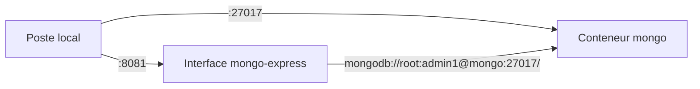

# Tutoriel 1 : Laboratoire Docker Standalone et Import de Jeux NDJSON

Dans ce tutoriel, vous validez et démarrez la pile autonome Docker (`docker/standalone/compose.yaml`), testez la connexion `mongosh` et contrôlez les fichiers NDJSON du dossier `datasets/`.

## Prérequis

- Docker Engine avec le greffon `docker compose`.
- Python 3 pour contrôler le format NDJSON avant import.

## Étape 1 : Valider la Définition Docker Compose Standalone

Contrôlez la syntaxe de `docker/standalone/compose.yaml` avant tout lancement :

```bash
docker compose -f docker/standalone/compose.yaml config -q
```



> **Note de sécurité laboratoire** : `docker/standalone/compose.yaml` fixe les identifiants de test `root` et `admin1`. Conservez ces valeurs uniquement sur un poste local isolé.

## Étape 2 : Démarrer les Conteneurs et Tester `mongosh`

```bash
docker compose -f docker/standalone/compose.yaml up -d
docker compose -f docker/standalone/compose.yaml ps
docker compose -f docker/standalone/compose.yaml exec mongo mongosh -u root -p admin1 --authenticationDatabase admin --eval "db.adminCommand({ ping: 1 })"
```

Réponse attendue dans la sortie :

```text
{ ok: 1 }
```

## Étape 3 : Contrôler et Importer les Données NDJSON

Le dossier `datasets/` regroupe trois fichiers JSON ligne par ligne (`books.json` : 150 lignes, `orders.json` : 1 000 lignes, `stocks.json` : 42 lignes) et `datasets/import.sh`. Vérifiez la validité JSON de chaque ligne :

```bash
python3 -c "import json, pathlib; [json.loads(line) for f in sorted(pathlib.Path('datasets').glob('*.json')) for line in f.read_text(encoding='utf-8').splitlines() if line.strip()]; print('3 jeux NDJSON valides')"
```

Importez `books.json` dans la base `training` :

```bash
docker compose -f docker/standalone/compose.yaml exec -T mongo mongoimport -u root -p admin1 --authenticationDatabase admin --db training --collection books --drop < datasets/books.json
```

## Étape 4 : Arrêter le Laboratoire

```bash
docker compose -f docker/standalone/compose.yaml down
```

## Étapes Suivantes

- Poursuivez avec le [Tutoriel 2 : Validation du Cluster Shardé Docker et Sauvegardes](02-cluster-sharde-et-sauvegardes.md).
- Consultez les procédures opérationnelles dans [Guides pratiques](../02-guides-pratiques/index.md).
- Consultez les fiches historiques détaillées dans [documentation/installation/install_mongodb_docker.md](../../../documentation/installation/install_mongodb_docker.md).
