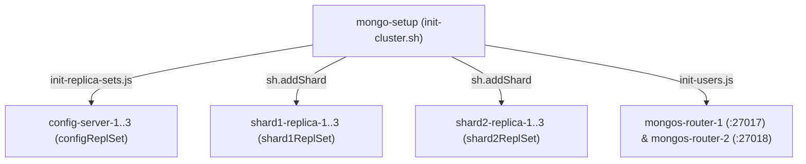

# Tutoriel 2 : Validation du Cluster Shardé Docker et Sauvegardes

Dans ce tutoriel, vous contrôlez l'architecture shardée Docker à 12 conteneurs (`docker/sharded/`), tracez l'initialisation JavaScript et validez la syntaxe Bash des scripts de sauvegarde logique et PITR.

## Prérequis

- Docker Compose (`docker compose` v2).
- Interpréteur `bash` pour les vérifications `bash -n`.

## Étape 1 : Valider la Topologie Shardée Hors Ligne

Le fichier `docker/sharded/docker-compose.yml` lit les variables définies dans `docker/sharded/.env_example` (`MONGO_VERSION=7.0`, ports `27017`–`27027`). Validez la résolution des variables sans démarrer de conteneur :

```bash
docker compose --env-file docker/sharded/.env_example -f docker/sharded/docker-compose.yml config -q
```



## Étape 2 : Vérifier les Scripts d'Initialisation du Cluster

Contrôlez la syntaxe des scripts de préparation sous `docker/sharded/init-scripts/` :

```bash
bash -n docker/sharded/init-scripts/init-datadir.sh docker/sharded/init-scripts/init-keyfile.sh docker/sharded/init-scripts/init-cluster.sh
```

Les scripts `init-replica-sets.js` et `init-users.js` utilisent des mots de passe codés en dur identiques à `docker/sharded/.env_example` (`SuperSecurePassword123`, `AdminPassword123`, `SuperAdminPassword123`).

## Étape 3 : Contrôler les Scripts de Sauvegarde Logique et PITR

Le dépôt fournit deux familles complémentaires de sauvegarde :

- **Sauvegardes logiques (`scripts/logical_backup.sh` / `logical_restore.sh`)** : `mongodump` avec `--oplog` optionnel, compression `.tar.gz`, empreinte `sha256sum` et chiffrement OpenSSL AES-256.
- **Sauvegardes PITR (`scripts/backups_pitr/mongo_backup.sh` / `mongo_restore.sh`)** : cycle `full` puis `incremental` via `local.oplog.rs`.

Validez la syntaxe des quatre scripts :

```bash
bash -n scripts/logical_backup.sh scripts/logical_restore.sh scripts/backups_pitr/mongo_backup.sh scripts/backups_pitr/mongo_restore.sh
```

> **Point d'attention technique** : La ligne `26` de `scripts/logical_backup.sh` exécute `exec > >(tee -a "${LOG_FILE}") 2>&1` avant le `mkdir -p` de la ligne `35`. Créez `/var/backups/mongodb` avant d'exécuter ce script sur un hôte neuf.

## Étapes Suivantes

- Exécutez les procédures opérationnelles : [Exécuter les sauvegardes logiques et PITR](../02-guides-pratiques/executer-sauvegardes-et-restaurations.md).
- Comparez les choix techniques : [Architecture des topologies et sauvegardes](../04-explications/architecture-topologies-et-sauvegardes.md).
- Fiches complémentaires : [script_backup.md](../../../documentation/sauvegarde-resturation/script_backup.md) et [scripts/backups_pitr/README.md](../../../scripts/backups_pitr/README.md).
