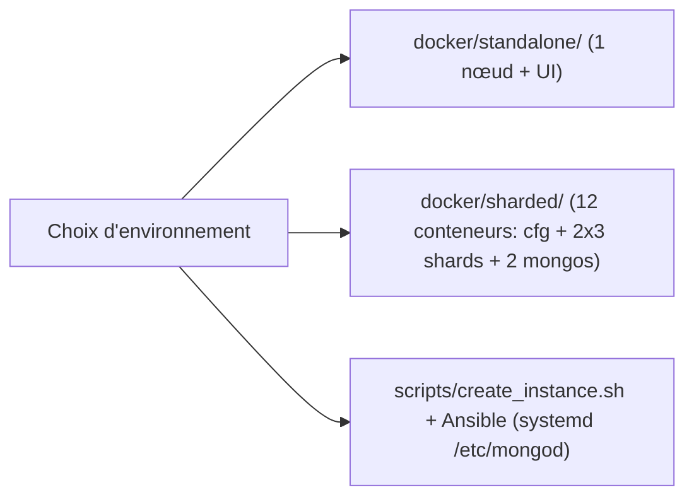

# Architecture des Topologies et Stratégies de Sauvegarde

**mongodb-training** associe deux environnements conteneurisés (`docker/standalone/` et `docker/sharded/`), des scripts hôtes multi-instances (`systemd`) et deux mécanismes distincts de sauvegarde sous `scripts/`. Chaque approche répond à un objectif pédagogique précis.

## Comparaison des Modes de Déploiement

| Critère | `docker/standalone/` | `docker/sharded/` | `scripts/` + `playbooks/` |
| :--- | :--- | :--- | :--- |
| **Usage ciblé** | Requêtes CRUD, `mongosh`, `mongoimport` | Routage `mongos`, clés de sharding, élections | Administration système Linux et `systemd` |
| **Empreinte** | `2` conteneurs (`mongo`, `mongo-express`) | `11` conteneurs persistants + `mongo-setup` | Unités `mongodb@.service` par `instance<N>` (`27016 + N`) |
| **Authentification** | Compte racine unique (`admin1`) | `keyFile` partagé + `init-users.js` | `create_admin_user.sh` et `create_db_users.sh` |
| **Oplog** | Absent (nœud standalone) | Actif sur `configReplSet`, `shard1ReplSet`, `shard2ReplSet` | Dépend de `replication.replSetName` |

## Choix des Stratégies de Sauvegarde : Logique vs PITR Oplog

1. **Archives Logiques Autonomes (`scripts/logical_backup.sh` / `logical_restore.sh`)** :
   - Privilégient la portabilité entre topologies `standalone`, `replicaset` et `sharded`.
   - Produisent une archive complète `.tar.gz` (ou chiffrée `.tar.gz.enc`) accompagnée d'un fichier `.sha256`.
   - Compromis : Volume d'entrées/sorties élevé lors d'exécutions fréquentes sur de grosses volumétries.

2. **Chaîne Complète + Incrémentielle Oplog (`scripts/backups_pitr/mongo_backup.sh` / `mongo_restore.sh`)** :
   - Associe un dump initial (`oplog_start_timestamp.txt`) à des captures delta de `local.oplog.rs` (`inc_*`).
   - Compromis : Exige un Replica Set ou shard disposant d'un oplog et une relecture chronologique sans rupture ; la perte d'un seul sous-dossier `inc_*` interrompt la cohérence après ce point.

## Compromis Sécurité et Dette Technique

Les secrets statiques présents dans `compose.yaml`, `.env_example`, les scripts JavaScript d'initialisation et `create_admin_user.sh` facilitent la reproductibilité des travaux pratiques mais interdisent tout déploiement direct hors laboratoire. Par ailleurs, la présence simultanée de `scripts/pitr_backup.sh` et `scripts/backups_pitr/mongo_backup.sh` constitue une dette de maintenance à unifier.

- Paramètres et anomalies vérifiés : [Référence des scripts et anomalies](../03-reference/scripts-compose-et-anomalies.md).
- Procédures opérationnelles : [Exécuter les laboratoires Docker](../02-guides-pratiques/executer-laboratoires-docker.md) et [Exécuter les sauvegardes logiques et PITR](../02-guides-pratiques/executer-sauvegardes-et-restaurations.md).
