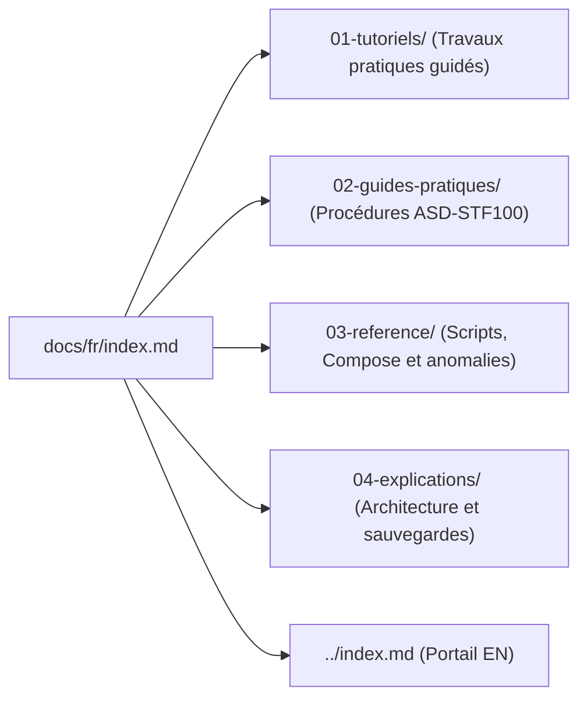

# Portail Documentaire MongoDB Training (Français)

Bienvenue sur le portail documentaire en français de **mongodb-training**, structuré selon le cadre **Diátaxis**.

> **Sélecteur de langue :** [English Portal (docs/index.md)](../index.md) | [Présentation FR (README.fr.md)](../../README.fr.md) | [Fiches de cours historique (documentation/)](../../documentation/test_environnements.md)

## Les Quatre Quadrants

| Quadrant | Objectif | Point d'entrée |
| :--- | :--- | :--- |
| **Tutoriels** | Apprentissage guidé sur Docker et scripts de sauvegarde | [01-tutoriels/index.md](01-tutoriels/index.md) |
| **Guides pratiques** | Procédures opérationnelles strictes (ASD-STF100 Édition 1) | [02-guides-pratiques/index.md](02-guides-pratiques/index.md) |
| **Référence** | Tables techniques des scripts, ports Docker et anomalies connues | [03-reference/index.md](03-reference/index.md) |
| **Explications** | Comparaisons architecturales des topologies et sauvegardes | [04-explications/index.md](04-explications/index.md) |
