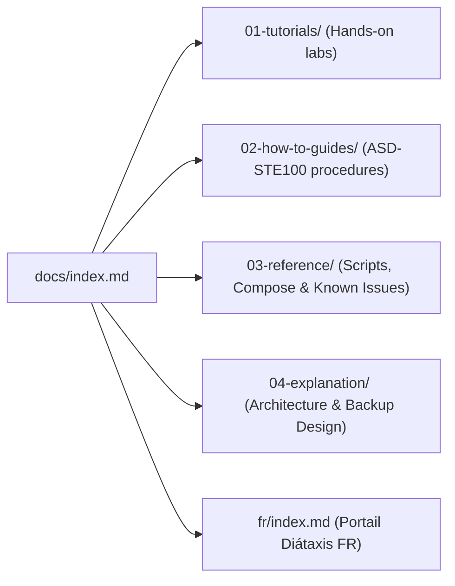

# MongoDB Training Documentation Portal (English)

Welcome to the **mongodb-training** English documentation portal organized with the **Diátaxis** framework.

> **Language switcher:** [Version française (docs/fr/index.md)](fr/index.md) | [Repository Overview](../README.md) | [Aperçu du dépôt (README.fr.md)](../README.fr.md)

## Quadrants

| Quadrant | Goal | Entry Point |
| :--- | :--- | :--- |
| **Tutorials** | Guided hands-on labs with Docker and backup scripts | [01-tutorials/index.md](01-tutorials/index.md) |
| **How-To Guides** | Task-focused operational runbooks (ASD-STE100 Issue 9) | [02-how-to-guides/index.md](02-how-to-guides/index.md) |
| **Reference** | Scripts, Compose ports, datasets, and upstream issue tables | [03-reference/index.md](03-reference/index.md) |
| **Explanation** | Design choices across standalone, sharded, and backup topologies | [04-explanation/index.md](04-explanation/index.md) |
