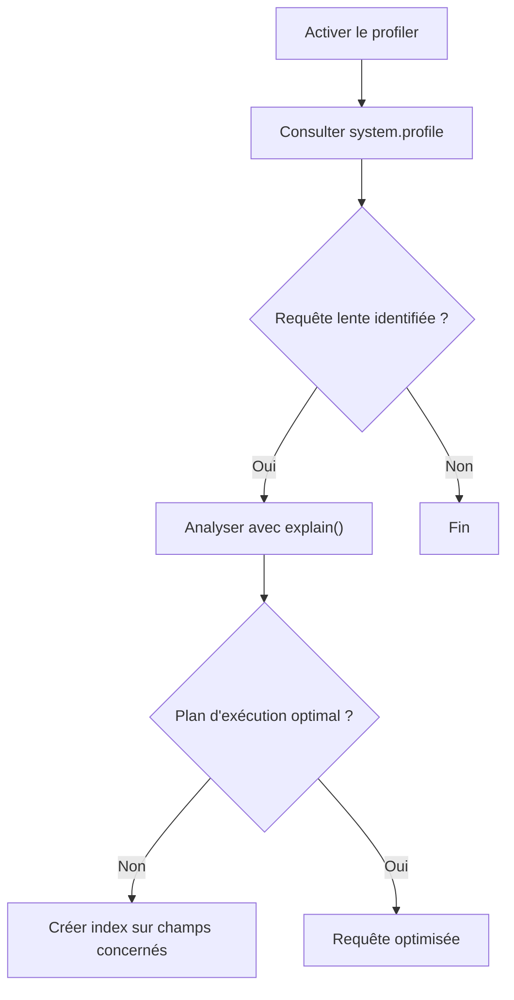

Voici une description technique détaillée du profiling et du suivi des requêtes lentes dans MongoDB, incluant l’utilisation du profileur et de la méthode `explain()`, ainsi que l’analyse et l’optimisation des plans d’exécution.

## 🛠️ Profiling et suivi des requêtes lentes

**Définition : Profiling**  
Le profiling consiste à enregistrer et analyser le comportement des requêtes et opérations exécutées sur une base MongoDB. Cela permet d’identifier les requêtes lentes, d’analyser leur plan d’exécution et d’optimiser les performances[1][2].

**Comment activer et configurer le profiling ?**  
Le profiler de MongoDB est activé et configuré via la commande `db.setProfilingLevel()` dans le shell Mongo. Il existe trois niveaux de profiling :

- **Niveau 0** : Désactive le profiler (aucune donnée enregistrée).
- **Niveau 1** : Enregistre uniquement les opérations lentes (au-delà d’un seuil défini, par défaut 100 ms).
- **Niveau 2** : Enregistre toutes les opérations (attention à l’impact sur la performance en production)[3][4][2].

**Exemple de configuration :**
```javascript
// Activer le profiler pour toutes les opérations lentes (> 200 ms)
db.setProfilingLevel(1, { slowms: 200 });

// Activer le profiler pour toutes les opérations
db.setProfilingLevel(2);
```
Le résultat de la commande indique l’ancien niveau de profiling et le nouveau seuil appliqué[3][5].

**Consultation des données du profiler :**  
Les données sont stockées dans la collection `system.profile` de la base courante. On peut interroger cette collection comme toute autre collection MongoDB pour analyser les requêtes lentes[5][2].

## 📊 Analyse du plan d’exécution avec `explain()`

**Définition : explain()**  
La méthode `explain()` permet d’analyser le plan d’exécution d’une requête sans l’exécuter réellement. Elle fournit des détails sur les étapes (stages) du plan de requête, l’utilisation ou non d’index, le nombre de documents analysés et le temps estimé d’exécution[6][7].

**Exemple d’utilisation :**
```javascript
db.collection.find({ champ: valeur }).explain();
```
Cette commande retourne le plan d’exécution, notamment le *winning plan* qui indique si la requête utilise un index ou effectue un scan complet de la collection (COLLSCAN)[6][7].

**Impact de l’indexation :**  
L’ajout d’un index sur les champs utilisés dans les filtres accélère considérablement les requêtes, car MongoDB peut éviter de scanner toute la collection[6][7].

## ✅ Avantages du profiling et de l’analyse des requêtes lentes

- **Identification rapide des requêtes lentes** grâce au profiler.
- **Analyse détaillée du plan d’exécution** avec `explain()`.
- **Optimisation ciblée** : création d’index sur les champs problématiques.
- **Surveillance en temps réel** pour détecter les goulots d’étranglement.

## ❌ Inconvénients

- **Impact sur la performance** : le niveau 2 du profiler peut générer beaucoup de données et ralentir le serveur, surtout en production.
- **Stockage supplémentaire** : les logs du profiler sont stockés dans la collection `system.profile`.
- **Complexité d’analyse** : nécessite une bonne compréhension des plans d’exécution et des index.

## ⚙️ Paramètres clés

| Paramètre    | Description                                                                 |
|--------------|-----------------------------------------------------------------------------|
| level        | Niveau de profiling : 0 (désactivé), 1 (seulement lentes), 2 (toutes)        |
| slowms       | Seuil en millisecondes pour définir une opération lente (par défaut 100 ms) |
| sampleRate   | Pourcentage d’opérations lentes à enregistrer (optionnel)                   |
| filter       | Filtre pour sélectionner les opérations à enregistrer (par type, durée, etc)|

**Exemple avancé :**
```javascript
db.setProfilingLevel(1, { filter: { op: "query", millis: { $gt: 2000 } } });
```
Ce filtre enregistre uniquement les requêtes qui durent plus de 2 secondes[3].

## 💻 Exemples pratiques

**1. Activer le profiler pour les requêtes lentes (plus de 200 ms)**
```javascript
db.setProfilingLevel(1, { slowms: 200 });
```

**2. Analyser le plan d’exécution d’une requête**
```javascript
db.collection.find({ champ: valeur }).explain();
```

**3. Vérifier le niveau actuel du profiler**
```javascript
db.getProfilingStatus();
```

## 📈 Diagramme : Flux de suivi et optimisation des requêtes lentes



## ⚠️ Points de vigilance

- **Impact sur la performance** : Le profiler, surtout au niveau 2, peut impacter la performance du serveur.
- **Sécurité** : Les données du profiler peuvent contenir des informations sensibles (requêtes, filtres).
- **Stockage** : La collection `system.profile` peut grossir rapidement sur des bases très actives.

## Résumé

Le profiling et le suivi des requêtes lentes dans MongoDB reposent sur l’activation du profiler (`db.setProfilingLevel()`), l’analyse des plans d’exécution (`explain()`), et l’optimisation via l’indexation. Ces outils permettent d’identifier, d’analyser et de corriger les goulots d’étranglement, mais nécessitent une configuration adaptée pour limiter l’impact sur les performances et la sécurité[3][6][2].

[1] https://www.softwaretestinghelp.com/mongodb/mongodb-database-profiler/
[2] https://severalnines.com/blog/overview-mongodb-database-profiler/
[3] https://www.mongodb.com/docs/manual/reference/method/db.setProfilingLevel/
[4] https://www.mongodb.com/docs/manual/tutorial/manage-the-database-profiler/
[5] https://www.w3resource.com/mongodb/shell-methods/database/db-setProfilingLevel.php
[6] https://fr.blog.businessdecision.com/tutoriel-mongodb-indexation-performance/
[7] https://docs.aws.amazon.com/fr_fr/documentdb/latest/developerguide/user_diagnostics.html
[8] https://www.xuchao.org/docs/mongodb/reference/method/db.setProfilingLevel.html
[9] https://axiansdb.com/tracer-les-requetes-lentes-sous-mongodb/
[10] https://severalnines.com/blog/performance-cheat-sheet-mongodb/