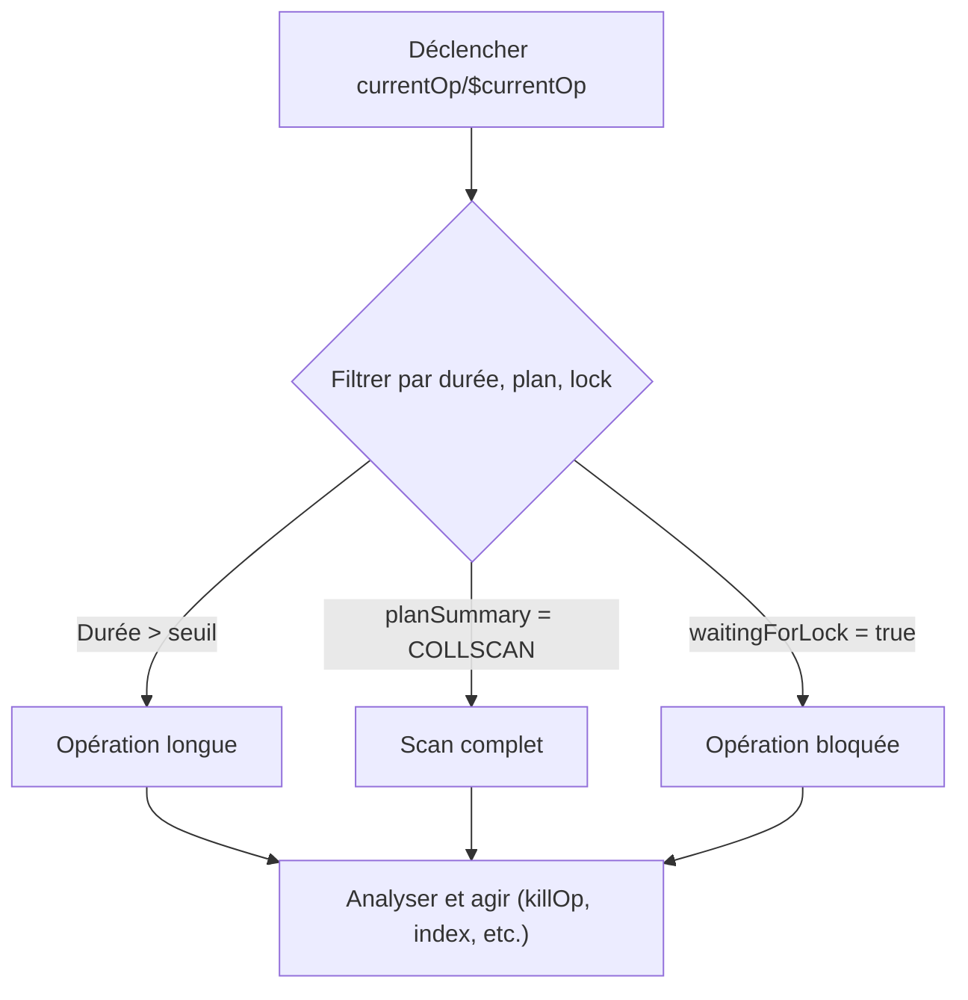

# Identifier une Opération Longue ou Problématique dans MongoDB

## 📊 Surveillance en Temps Réel : currentOp & $currentOp

Pour détecter une opération longue ou problématique, MongoDB propose des commandes d’administration permettant d’inspecter les opérations en cours sur l’instance.

### Principales Commandes

- `db.currentOp()` : Affiche toutes les opérations en cours sur le nœud courant.
- Pipeline d’agrégation avec `$currentOp` : Permet des filtres avancés et n’est pas limité par la taille BSON de 16MB.

#### Exemple de détection d’opérations longues

```javascript
// Afficher les opérations actives depuis plus de 10 secondes
db.currentOp({ "secs_running": { $gt: 10 } })
```
Ou en pipeline d’agrégation :
```javascript
db.adminCommand({
  aggregate: 1,
  pipeline: [
    { $currentOp: {} },
    { $match: { secs_running: { $gt: 10 } } }
  ],
  cursor: {}
})
```
Ces requêtes retournent les opérations dont la durée d’exécution dépasse le seuil défini (ici 10 secondes)[1][2].

### Champs Clés à Surveiller

| Champ             | Description                                      |
|-------------------|--------------------------------------------------|
| `opid`            | Identifiant unique de l’opération                |
| `secs_running`    | Durée d’exécution en secondes                    |
| `active`          | Statut actif de l’opération                      |
| `op`              | Type d’opération (query, insert, update, etc.)   |
| `ns`              | Namespace (base.collection)                      |
| `planSummary`     | Plan d’exécution (ex : `COLLSCAN`, `IXSCAN`)     |
| `waitingForLock`  | Indique si l’opération attend un verrou          |
| `command`         | Détail de la commande exécutée                   |

#### Indicateurs d’une opération problématique

- **Durée élevée** : `secs_running` ou `microsecs_running` importants.
- **Plan d’exécution inefficace** : `planSummary` à `COLLSCAN` (scan complet de collection).
- **Blocage** : `waitingForLock: true` ou présence du champ `WaitState`.
- **Nombre de yields élevé** : `numYields` important peut indiquer une contention.
- **Namespace critique** : Opérations sur des collections sensibles ou volumineuses.

### 💻 Exemples de Filtres Avancés

```javascript
// Opérations longues utilisant un scan complet de collection
db.currentOp({
  "secs_running": { $gt: 5 },
  "planSummary": "COLLSCAN"
})

// Opérations en attente de verrou
db.currentOp({
  "waitingForLock": true
})
```
Vous pouvez également projeter uniquement les champs utiles pour l’analyse[3].

## ✅ Avantages

- **Détection proactive** : Identification rapide des requêtes lentes ou bloquées.
- **Filtrage précis** : Possibilité de cibler par durée, type, namespace, plan d’exécution.
- **Action immédiate** : Possibilité de terminer (`killOp`) une opération problématique.

## ❌ Inconvénients

- **Bruit** : Beaucoup d’opérations système ou internes peuvent apparaître, nécessitant un filtrage.
- **Analyse manuelle** : L’interprétation des résultats peut demander une expertise.
- **Impact sur la performance** : Un monitoring trop fréquent peut impacter légèrement le système[4].

## ⚙️ Paramètres et Bonnes Pratiques

| Paramètre         | Utilité                                         |
|-------------------|-------------------------------------------------|
| `secs_running`    | Seuil de durée pour filtrer les opérations      |
| `planSummary`     | Détecter les scans complets (`COLLSCAN`)        |
| `waitingForLock`  | Identifier les opérations bloquées              |
| `ns`              | Cibler une base ou collection spécifique        |
| `active`          | Ne garder que les opérations actives            |

## 📈 Diagramme Mermaid : Processus d’Identification



## ⚠️ Points de Vigilance

- **Ne pas tuer les opérations système** : Filtrer sur le champ `desc` pour éviter d’interrompre des tâches internes.
- **Transactions** : Les opérations en transaction peuvent nécessiter une gestion spécifique.
- **Sécurité** : L’accès à ces commandes doit être restreint aux administrateurs.
- **Surveillance continue** : Mettre en place des alertes automatiques sur les seuils critiques.

En résumé, l’identification d’une opération longue ou problématique repose sur l’utilisation de `currentOp` ou `$currentOp` avec des filtres adaptés sur la durée, le plan d’exécution, le statut de verrou et le type d’opération. L’analyse des champs clés permet d’agir rapidement pour préserver la performance et la stabilité du système[1][2][3].

[1] https://docs.aws.amazon.com/fr_fr/documentdb/latest/developerguide/user_diagnostics.html
[2] https://foojay.io/today/your-complete-guide-to-diagnose-slow-queries-in-mongodb/
[3] https://stackoverflow.com/questions/63336494/mongodb-how-to-filter-db-admincommand-output
[4] https://community.appdynamics.com/t5/Infrastructure-Server-Network/MongoDB-monitoring-shows-quot-currentOp-quot-as-top-query-which/m-p/29786
[5] https://www.mongodb.com/fr-fr/resources/products/fundamentals/crud
[6] https://www.mongodb.com/docs/manual/crud/
[7] https://kinsta.com/fr/blog/operateurs-mongodb/
[8] https://www.mongodb.com/docs/manual/reference/operator/update/positional-filtered/
[9] https://welovedevs.com/fr/articles/mongodb-index/
[10] https://stackoverflow.com/questions/58365361/mongodb-currentop-and-cursor-explain-shows-different-result-for-the-same-que
[11] https://stackoverflow.com/questions/44315827/how-can-a-mongodb-client-save-the-operation-id-sent-to-database-to-kill-it-after
[12] https://tech.indy.fr/2023/03/30/ameliorer-ses-requetes-mongo-avec-atlas-et-explain/
[13] https://studio3t.com/knowledge-base/articles/mongodb-current-operations/
[14] https://www.mongodb.com/docs/manual/core/data-model-operations/
[15] https://welovedevs.com/fr/articles/mongodb/
[16] https://docs.aws.amazon.com/fr_fr/documentdb/latest/developerguide/mongo-apis.html
[17] https://www.mongodb.com/blog/post/performance-best-practices-indexing-fr
[18] https://www.mongodb.com/docs/manual/reference/method/db.currentOp/
[19] https://rtavenar.github.io/mongo_book/content/01_find.html
[20] https://www.reddit.com/r/mongodb/comments/1agpu73/my_mongodb_is_really_slow_what_to_do/?tl=fr
[21] https://blog.ippon.fr/2019/01/10/trois-ans-en-compagnie-de-mongodb-part-2-joie/
[22] https://www.mongodb.com/docs/manual/reference/operator/aggregation/currentOp/
[23] https://www.mongodb.com/docs/manual/reference/command/currentOp/
[24] https://www.percona.com/blog/whats-running-in-my-db-a-journey-with-currentop-in-mongodb/
[25] https://www.manageengine.com/fr/applications_manager/mongodb-monitoring.html
[26] https://rubrr.s3-main.oktopod.app/questions/530
[27] https://www.datasunrise.com/fr/surveillance-des-performances/mongodb/
[28] https://geekflare.com/fr/mongodb-queries-examples/
[29] https://www.mongodb.com/community/forums/t/mongodb-changestream-getmore-runs-as-collscans/160433
[30] https://welovedevs.com/fr/articles/mongo-shell/
[31] https://www.datacamp.com/fr/blog/mongodb-interview-questions
[32] https://hackernoon.com/mongodb-currentop-18fe2f9dbd68
[33] https://fr.slideshare.net/slideshow/alphormcomformation-mongodb-administrationss/38637343
[34] https://www.mongodb.com/docs/manual/tutorial/evaluate-operation-performance/
[35] https://www.mongodb.com/docs/v6.0/reference/command/currentOp/
[36] https://www.mongodb.com/fr-fr/solutions/use-cases/analytics/real-time-analytics