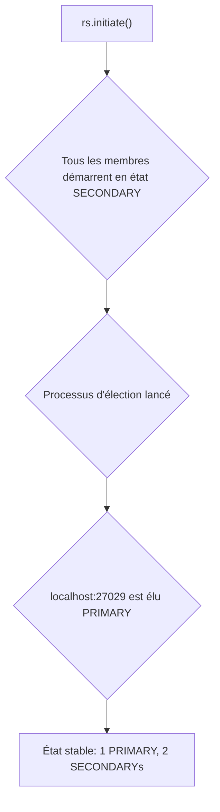

Voici une analyse détaillée de la configuration et de l'état de votre Replica Set MongoDB.

### ⚙️ Configuration et Initialisation

La commande `rs.initiate()` a été utilisée pour créer et configurer un nouveau Replica Set.

💻 **Commande d'initialisation**
```javascript
rs.initiate({
   _id: "configRS",
   configsvr: true, // Spécifie que c'est un CSRS
   members: [
      { _id: 0, host: "localhost:27029" },
      { _id: 1, host: "localhost:27030" },
      { _id: 2, host: "localhost:27031" }
   ]
})
```

**Analyse des paramètres :**
*   `_id: "configRS"` : C'est le nom du Replica Set. Il est essentiel pour que les membres puissent s'identifier et communiquer.
*   `configsvr: true` : Ce paramètre est crucial. Il indique que ce Replica Set est destiné à être utilisé comme **serveur de configuration (Config Server Replica Set - CSRS)** pour un cluster Shardé. Il modifie certains comportements par défaut pour ce rôle spécifique.
*   `members` : Ce tableau définit la liste des membres du Replica Set. Chaque membre est identifié par un `_id` unique (à partir de 0) et son `host` (adresse et port).

Le retour `{ ok: 1 }` confirme que l'initialisation a été acceptée par le membre sur lequel la commande a été exécutée.

### 📊 État et Analyse du Replica Set

L'analyse des commandes `rs.status()` et `rs.isMaster()` (ou `db.hello()`) permet de comprendre l'état de santé et la topologie du cluster après son initialisation.

#### Diagnostic initial avec `rs.status()`

Cette commande a été exécutée juste après l'initialisation, alors que le processus d'élection d'un `PRIMARY` n'était pas encore terminé.

**Points clés de la sortie `rs.status()` :**
*   `set: 'configRS'` : Le nom du Replica Set est correct.
*   `myState: 2` : Le membre sur lequel la commande a été exécutée (`localhost:27029`) est un `SECONDARY`.
*   `members` : Le tableau montre que les 3 membres (`_id: 0`, `_id: 1`, `_id: 2`) sont présents, avec un état de santé (`health: 1`) et un état de membre (`stateStr: 'SECONDARY'`) corrects. C'est une situation normale et transitoire juste après l'initiation, avant qu'un primaire ne soit élu.
*   `majorityVoteCount: 2` et `writeMajorityCount: 2` : Pour ce cluster de 3 membres, il faut un quorum de 2 membres pour élire un nouveau primaire et pour confirmer une écriture avec une `write concern` de `majority`.

#### Confirmation du Primaire avec `rs.isMaster()`

Cette commande a été exécutée un peu plus tard et montre l'état stable du Replica Set après l'élection.

**Points clés de la sortie `rs.isMaster()` :**
*   `ismaster: true` : Indique que le membre interrogé (`localhost:27029`) est bien le `PRIMARY`.
*   `primary: 'localhost:27029'` : Confirme l'adresse du membre `PRIMARY` pour l'ensemble du Replica Set.
*   `secondary: false` : Le membre interrogé n'est pas un `SECONDARY`.
*   `hosts`: Liste tous les membres connus du Replica Set.
*   `isWritablePrimary: true`: Confirme que ce membre est non seulement `PRIMARY` mais qu'il peut également accepter les opérations d'écriture.

#### 📈 Diagramme de flux d'élection

Le processus observé peut être résumé par le diagramme de flux suivant :



#### 📋 Tableau récapitulatif des membres

| Membre | Hôte | Rôle | État final | Santé |
| :--- | :--- | :--- | :--- | :--- |
| `_id: 0` | `localhost:27029` | Serveur de configuration | **PRIMARY** | ✅ En ligne (`health: 1`) |
| `_id: 1` | `localhost:27030` | Serveur de configuration | `SECONDARY` | ✅ En ligne (`health: 1`) |
| `_id: 2` | `localhost:27031` | Serveur de configuration | `SECONDARY` | ✅ En ligne (`health: 1`) |

### ✅ Avantages de cette configuration

*   **Haute Disponibilité** : Avec 3 membres, le Replica Set peut tolérer la perte d'un membre sans interruption de service pour les lectures et les écritures.
*   **Consistance des Données** : La majorité requise de 2 membres pour valider les écritures (`writeMajorityCount: 2`) garantit que les données confirmées sont stockées sur au moins deux serveurs, prévenant ainsi les rollbacks en cas de bascule du primaire.
*   **Configuration Standard** : L'architecture PSS (Primaire-Secondaire-Secondaire) est la topologie la plus courante et recommandée pour un Replica Set de 3 membres.

### ⚠️ Points de vigilance

*   **Déploiement sur Hôte Unique** : Tous les membres sont déployés sur `localhost`. Dans un environnement de production, cela constitue un **point de défaillance unique (Single Point of Failure)**. Si la machine physique tombe en panne, l'ensemble du Replica Set sera perdu. Pour une résilience réelle, chaque membre doit être sur une machine physique distincte, idéalement dans des racks ou des zones de disponibilité différentes.
*   **Sécurité** : Les logs ne montrent aucune configuration d'authentification ou de chiffrement. Pour la production, il est impératif de configurer :
    *   **Le contrôle d'accès** (utilisateurs, mots de passe, rôles) pour protéger les données.
    *   **Le chiffrement réseau** (TLS/SSL) pour sécuriser les communications entre les membres du cluster et les clients.
    *   **Le chiffrement au repos** pour protéger les fichiers de données sur le disque.
*   **Absence de Membre Arbitre** : Cette configuration n'utilise pas d'arbitre, ce qui est une bonne pratique. Les arbitres ne stockent pas de données et peuvent être problématiques dans certaines situations de panne réseau. La configuration actuelle avec trois membres votants est plus robuste.