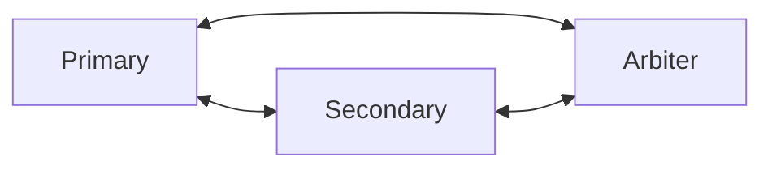

# ⚙️ Configuration d’un arbitre dans un replica set MongoDB

## Définition : Rôle de l’arbitre

Un **arbitre** dans un replica set MongoDB est un nœud qui ne stocke aucune donnée. Il participe uniquement aux élections pour déterminer quel nœud doit être primaire. L’arbitre est utilisé pour garantir un nombre impair de votes, essentiel pour éviter les situations de split-brain et assurer la haute disponibilité, notamment lorsque le coût ou la capacité ne permettent pas d’ajouter un nœud secondaire supplémentaire[1][2].

## ✅ Avantages

- **Faible consommation de ressources** : l’arbitre ne stocke pas de données et n’a pas besoin de beaucoup de CPU ou de RAM[3][2].
- **Maintien de la haute disponibilité** : permet d’avoir un nombre impair de votes et donc d’éviter les blocages lors des élections[4][2].
- **Simplicité de déploiement** : peut être installé sur un serveur existant, à condition qu’il ne soit pas déjà membre du replica set[5][3].

## ❌ Inconvénients

- **Pas de redondance des données** : l’arbitre ne contribue pas à la réplication des données.
- **Risque de perte de quorum** : si l’arbitre et un autre nœud tombent en panne, le replica set peut perdre le quorum.
- **Ne jamais déployer plusieurs arbitres** : cela augmente le risque d’incohérences lors des élections et n’apporte aucun bénéfice supplémentaire[1][4].

## 💻 Étapes de configuration

### 1. Démarrer l’instance mongod de l’arbitre

Créez un répertoire pour l’arbitre et lancez une instance mongod dédiée :

```bash
mkdir /srv/mongodb/arbiter
mongod --replSet nomReplicaSet --port 27018 --dbpath /srv/mongodb/arbiter --fork --logpath /srv/mongodb/arbiter/mongod.log
```
- **--replSet** : nom du replica set (doit être identique à celui des autres membres)
- **--port** : port d’écoute (doit être unique sur le serveur)
- **--dbpath** : répertoire vide (aucune donnée n’y sera stockée)[6][7][2]

### 2. Ajouter l’arbitre au replica set

Connectez-vous au shell mongo sur le primaire, puis exécutez :

```js
rs.addArb("hostname:27018")
```
- Remplacez `hostname:27018` par l’adresse et le port de votre arbitre[6][2].

### 3. Vérifier la configuration

Utilisez :

```js
rs.status()
```
L’arbitre doit apparaître avec le statut `ARBITER`[7].

## 📊 Tableau récapitulatif des paramètres essentiels

| Paramètre         | Description                                              | Exemple                      |
|-------------------|---------------------------------------------------------|------------------------------|
| --replSet         | Nom du replica set                                      | --replSet rs0                |
| --port            | Port d’écoute de l’arbitre                              | --port 27018                 |
| --dbpath          | Répertoire de données (vide pour l’arbitre)             | --dbpath /srv/mongodb/arbiter|
| rs.addArb()       | Ajout de l’arbitre via le shell mongo                   | rs.addArb("host:port")       |

## ⚠️ Points de vigilance

- **Un seul arbitre par replica set** : n’ajoutez jamais plusieurs arbitres, cela peut provoquer des problèmes d’élection et de cohérence[1][4].
- **Ne pas héberger l’arbitre sur le même serveur qu’un membre principal** : en cas de panne du serveur, vous perdez le quorum[4][3].
- **Sécurité** : l’arbitre doit être protégé par les mêmes mécanismes de sécurité (authentification, réseau) que les autres membres du replica set[8].
- **Pas de stockage de données** : ne comptez pas sur l’arbitre pour la sauvegarde ou la restauration de données.

## Exemple complet

Supposons un replica set nommé `rs0` avec deux nœuds data et un arbitre :

1. Démarrez l’arbitre :
   ```bash
   mongod --replSet rs0 --port 27018 --dbpath /srv/mongodb/arbiter --fork --logpath /srv/mongodb/arbiter/mongod.log
   ```

2. Depuis le shell mongo du primaire :
   ```js
   rs.addArb("arbiter-host:27018")
   ```

3. Vérifiez :
   ```js
   rs.status()
   ```

## 📈 Diagramme Mermaid : Architecture typique avec arbitre



Cette configuration permet de garantir la disponibilité de votre cluster MongoDB tout en limitant les ressources nécessaires, à condition de respecter les bonnes pratiques ci-dessus[1][4][2].

[1] https://www.mongodb.com/docs/manual/core/replica-set-arbiter/
[2] https://severalnines.com/blog/mongodb-replication-best-practices/
[3] https://stackoverflow.com/questions/18211154/why-do-we-need-an-arbiter-in-mongodb-replication
[4] https://www.openmymind.net/Does-My-Replica-Set-Need-An-Arbiter/
[5] https://www.mongodb.com/docs/manual/core/replica-set-architectures/
[6] http://andreiarion.github.io/TP7_MongoDB_Replication_exercices
[7] https://iitbitz.wordpress.com/2016/03/14/how-to-setup-mongodb-replication-using-replica-set-and-arbiters/
[8] https://nosql.developpez.com/faq/mongodb/?page=Replication-et-Replica-Sets
[9] https://www.mongodb.com/docs/manual/tutorial/add-replica-set-arbiter/
[10] https://kinsta.com/fr/blog/ensemble-repliques-mongodb/
[11] https://www.checkmateq.com/blog/mongodb-replication-with-arbiter
[12] https://www.scribd.com/document/580426753/TP3
[13] https://www.mongodb.com/community/forums/t/best-practices-replicaset-mongodb/129056
[14] https://www.mongodb.com/docs/manual/core/replica-set-members/
[15] https://www.mongodb.com/docs/manual/tutorial/deploy-replica-set/
[16] https://www.mongodb.com/community/forums/t/replica-set-with-3-db-nodes-and-1-arbiter/5599
[17] https://www.mongodb.com/community/forums/t/arbiter-configuration/194149
[18] https://www.reddit.com/r/mongodb/comments/j5ekwy/how_to_setup_mongodb_to_manually_switch_primary/?tl=fr
[19] https://www.mongodb.com/docs/manual/core/replica-set-architecture-three-members/