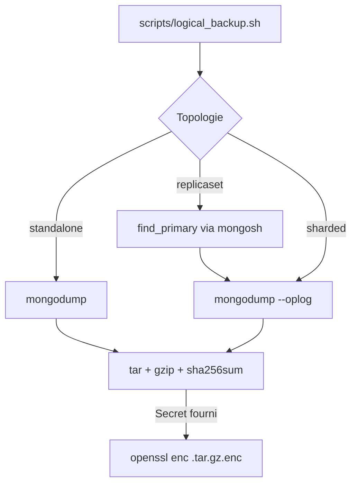

# Script de Sauvegarde Logique MongoDB (`scripts/logical_backup.sh`)

Ce document présente le script Bash [scripts/logical_backup.sh](../../scripts/logical_backup.sh) conçu pour automatiser les sauvegardes logiques (`mongodump`) de MongoDB sur topologies standalone, replica set et sharded cluster.

> **Note technique** : L'en-tête interne de [scripts/logical_backup.sh](../../scripts/logical_backup.sh) mentionne encore l'ancien nom `mongodb_backup.sh`, et la ligne `26` redirige les logs vers `/var/backups/mongodb/mongodb_backup.log` avant le `mkdir -p` de la ligne `35`. Créez `/var/backups/mongodb` au préalable sur un système neuf.

## Table des Matières

* [Fonctionnalités](#fonctionnalités)
* [Avertissement de Sécurité](#avertissement-de-sécurité)
* [Prérequis](#prérequis)
* [Utilisation](#utilisation)
  * [Syntaxe Générale](#syntaxe-générale)
  * [Exemples d'Utilisation](#exemples-dutilisation)
* [Détails Techniques](#détails-techniques)
* [Restauration](#restauration)
* [Planification et Maintenance](#planification-et-maintenance)

## Fonctionnalités

* **Prise en charge Multi-Topologie** : Sauvegarde des instances MongoDB `standalone`, des `replicaset` et des clusters `sharded`.
* **Détection du Primaire** : Sur replica set, la fonction `find_primary` interroge `rs.isMaster()` via `mongosh` afin de cibler le nœud primaire.
* **Sauvegarde Cohérente** : Ajoute `--oplog` à `mongodump` pour les replica sets et clusters shardés.
* **Compression Automatique** : Empaquette le dump dans une archive `.tar.gz`.
* **Vérification d'Intégrité** : Calcule une empreinte `sha256sum` pour l'archive générée.
* **Chiffrement Optionnel** : Chiffre l'archive avec OpenSSL AES-256 (`-aes-256-cbc` + `.tar.gz.enc`) lorsqu'un mot de passe de chiffrement est fourni.
* **Journalisation** : Écrit les traces dans `/var/backups/mongodb/mongodb_backup.log` et sur la console.

## Avertissement de Sécurité

Évitez de transmettre des mots de passe en clair sur la ligne de commande en production. Réservez les paramètres en ligne de commande aux environnements de laboratoire et utilisez un fichier protégé (`0600`) ou un coffre de secrets en production.

## Prérequis

* **Système d'exploitation** : Linux Debian / Ubuntu (Ubuntu 24.04 recommandé).
* **Outils MongoDB** : `mongodump` et `mongosh`.
* **Outils Système** : `tar`, `gzip`, `sha256sum`, `openssl` (si chiffrement activé).
* **Permissions** : Droits d'écriture sur `/var/backups/mongodb/` et rôle MongoDB `backup` ou `read` (plus `clusterMonitor` sur replica set ou sharded cluster).

## Utilisation

Rendez le script exécutable puis créez le répertoire cible si nécessaire :

```bash
sudo mkdir -p /var/backups/mongodb
chmod +x scripts/logical_backup.sh
```

### Syntaxe Générale

```bash
bash ./scripts/logical_backup.sh <TYPE_DE_SAUVEGARDE> <HOST> <PORT> [USERNAME] [PASSWORD] [AUTH_DB] [ENCRYPTION_PASSWORD]
```

* `<TYPE_DE_SAUVEGARDE>` : `standalone`, `replicaset` ou `sharded`.
* `<HOST>` : Adresse IP ou nom d'hôte de l'instance MongoDB ou du routeur `mongos`.
* `<PORT>` : Port d'écoute MongoDB.
* `[USERNAME]` : Nom d'utilisateur MongoDB (optionnel).
* `[PASSWORD]` : Mot de passe MongoDB (optionnel).
* `[AUTH_DB]` : Base d'authentification (optionnel, défaut `admin`).
* `[ENCRYPTION_PASSWORD]` : Secret OpenSSL pour générer `.tar.gz.enc` (optionnel).

### Exemples d'Utilisation

1. **Sauvegarde d'une instance Standalone**

```bash
# Sans authentification ni chiffrement
bash ./scripts/logical_backup.sh standalone localhost 27017

# Avec authentification et chiffrement
bash ./scripts/logical_backup.sh standalone localhost 27017 admin strongpass admin mySuperSecretKey
```

2. **Sauvegarde d'un Replica Set**

```bash
bash ./scripts/logical_backup.sh replicaset rs0-member1.example.com 27017 backupUser backupPass admin myReplicaSetKey
```

3. **Sauvegarde d'un Sharded Cluster (via `mongos`)**

```bash
bash ./scripts/logical_backup.sh sharded my-mongos.example.com 27020 adminUser adminPass admin myShardedClusterKey
```

## Détails Techniques



## Restauration

Pour restaurer manuellement une archive produite par `scripts/logical_backup.sh`, ou utilisez directement [scripts/logical_restore.sh](../../scripts/logical_restore.sh) (décrit dans [script_restauration.md](script_restauration.md)) :

```bash
# 1. Déchiffrer l'archive si elle se termine par .enc
openssl enc -aes-256-cbc -d -in "/path/to/backup_file.tar.gz.enc" -out "/path/to/backup_file.tar.gz" -k "YOUR_ENCRYPTION_PASSWORD"

# 2. Extraire l'archive
tar -xzf "/path/to/backup_file.tar.gz" -C "/your/restore/directory"

# 3. Restaurer avec mongorestore (--oplogReplay si sauvegarde replica set / sharded)
mongorestore --host <TARGET_HOST> --port <TARGET_PORT> --username <USERNAME> --password <PASSWORD> --authenticationDatabase <AUTH_DB> --oplogReplay "/your/restore/directory/backup_data_timestamp"
```

## Planification et Maintenance

* **Planification cron** : Planifiez `scripts/logical_backup.sh` en exécution quotidienne avec redirection vers un journal surveillé.
* **Politique de rétention** : Purge périodique des archives expirées et copie hors site (stockage objet ou NFS).
* **Supervision** : Vérifiez `/var/backups/mongodb/mongodb_backup.log` et la présence des fichiers `.sha256` après chaque exécution.
