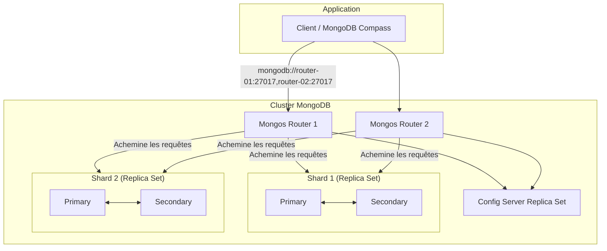

Ce projet GitHub, `minhhungit/mongodb-cluster-docker-compose`, fournit une configuration **Docker Compose** pour déployer rapidement un **cluster MongoDB shardé complet** sur un environnement local [1][2]. Son objectif principal est de simplifier la mise en place d'une architecture complexe, normalement fastidieuse à configurer manuellement, pour des besoins de développement et de test [3].

Le cluster déployé n'est pas un simple Replica Set, mais une architecture de sharding complète, qui inclut :
*   Des **routeurs `mongos`** qui servent de point d'entrée pour les applications.
*   Un **Replica Set de serveurs de configuration** (`configsvr`) pour stocker les métadonnées du cluster.
*   Plusieurs **Replica Sets de shards** (`shard`) pour stocker les données de manière distribuée [4].

### 📈 Diagramme d'Architecture

L'architecture d'un cluster shardé déployé par ce projet peut être représentée comme suit :



### ✅ Avantages

*   **Déploiement Simplifié** : Lance un cluster shardé complet avec une seule commande, évitant les multiples étapes manuelles de configuration des `docker run` et `rs.initiate()` [3][5].
*   **Environnement Reproductible** : Garantit un environnement de développement identique pour tous les membres d'une équipe, grâce à la nature déclarative de Docker Compose.
*   **Configuration Automatisée** : Le projet gère l'initialisation des Replica Sets pour les shards et les serveurs de configuration, ainsi que la liaison avec les routeurs `mongos` [1].
*   **Test d'Architectures Complexes** : Permet de tester des applications sur une architecture distribuée qui se rapproche des environnements de production, notamment pour valider les stratégies de sharding.

### 💻 Commandes de Lancement

Pour gérer le cycle de vie du cluster, utilisez les commandes Docker Compose standards à la racine du projet cloné.

1.  **Démarrer le cluster en arrière-plan :**
    La commande `up` télécharge les images, crée les conteneurs, les réseaux et les volumes, puis lance les services définis dans le fichier `docker-compose.yml` [5].
    ```bash
    docker-compose up -d
    ```

2.  **Arrêter et supprimer le cluster :**
    Cette commande arrête et supprime les conteneurs, les réseaux et (optionnellement) les volumes associés au projet [3].
    ```bash
    docker-compose down
    ```

3.  **Consulter les logs en temps réel :**
    Très utile pour suivre l'initialisation du cluster ou pour déboguer des erreurs.
    ```bash
    docker-compose logs -f
    ```

4.  **Se connecter à un conteneur (par exemple, un routeur `mongos`) :**
    Permet d'accéder à un shell `mongosh` pour interagir directement avec le cluster.
    ```bash
    docker-compose exec router-01 mongosh
    ```

### 📊 Tableau Récapitulatif des Composants

Le fichier `docker-compose.yml` du projet déploie plusieurs services interconnectés. Voici un résumé de leurs rôles [4].

| Composant | Rôle Principal | Services Docker (Exemples) |
| :--- | :--- | :--- |
| **Routeur (`mongos`)** | Point d'entrée unique pour les applications. Achemine les requêtes vers le bon shard. | `router-01`, `router-02` |
| **Serveurs de Config** | Replica Set qui stocke les métadonnées du cluster (ex: mapping des chunks vers les shards). | `configsvr01`, `configsvr02`, `configsvr03` |
| **Shard (Replica Set)** | Replica Set qui stocke une partie des données. Assure la haute disponibilité des données du shard. | `shard01-a`, `shard01-b`, `shard02-a`, `shard02-b` |

Pour se connecter depuis un outil externe comme MongoDB Compass, il faut utiliser la chaîne de connexion pointant vers les routeurs `mongos`, comme indiqué dans le `README` du projet [2].

### ⚠️ Points de vigilance

*   **Utilisation des Ressources** : Le déploiement d'un cluster shardé complet consomme beaucoup plus de RAM et de CPU qu'un simple conteneur MongoDB. Assurez-vous que votre machine hôte dispose de ressources suffisantes.
*   **Configuration pour le Développement** : Ce projet est conçu pour des environnements de développement et de test. Pour une utilisation en production, des mesures de sécurité supplémentaires (gestion des secrets, configuration réseau, sauvegardes) sont indispensables.
*   **Persistance des Données** : Par défaut, Docker Compose peut utiliser des volumes nommés pour la persistance. Assurez-vous de comprendre leur gestion, notamment lors de l'utilisation de `docker-compose down -v` qui supprime également les volumes et donc les données.

[1] https://github.com/minhhungit/mongodb-cluster-docker-compose
[2] https://dev.to/denisakp/setting-up-a-3-node-mongodb-replica-set-cluster-with-docker-compose-50kn
[3] https://dev.to/mattdark/deploy-a-mongodb-cluster-with-docker-compose-4ieo
[4] https://stackoverflow.com/questions/50536812/how-to-run-mongo-shell-command-after-docker-compose
[5] https://github.com/minhhungit/mongodb-cluster-docker-compose/blob/master/PSA/docker-compose.yml
[6] https://www.mongodb.com/resources/products/compatibilities/deploying-a-mongodb-cluster-with-docker
[7] https://collabnix.com/how-to-run-mongodb-with-docker-and-docker-compose-a-step-by-step-guide/
[8] https://www.giorgosdimtsas.net/blog/docker-compose-for-a-local-mongodb-cluster/