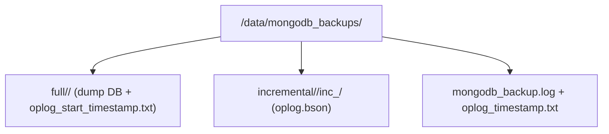

# Documentation des Stratégies de Sauvegarde et Restauration PITR MongoDB

Cette documentation décrit le fonctionnement des scripts Bash situés dans [scripts/backups_pitr/](.): [mongo_backup.sh](mongo_backup.sh) (sauvegarde complète et incrémentielle via oplog) et [mongo_restore.sh](mongo_restore.sh) (restauration complète suivie des incrémentales).

> **Note dépôt** : Une copie quasi identique de `mongo_backup.sh` existe à l'emplacement [../pitr_backup.sh](../pitr_backup.sh) (seules 2 lignes de commentaire final diffèrent).

## 1. Stratégie de Sauvegarde MongoDB

La stratégie s'appuie sur `mongodump` et sur le journal des opérations (`oplog`) d'un Replica Set afin de combiner sauvegardes complètes (`full`) et incrémentielles (`incremental`).

### 1.1. Concepts Clés

* **Sauvegarde Complète (`full`)** : Copie intégrale des bases ciblées servant de socle à la restauration.
* **Sauvegarde Incrémentielle (`incremental`)** : Capture des écritures survenues dans l'oplog (`local.oplog.rs`) depuis le dernier horodatage enregistré.
* **Oplog (`local.oplog.rs`)** : Journal circulaire présent sur les Replica Sets enregistrant chaque écriture idempotente.

### 1.2. Script de Sauvegarde (`mongo_backup.sh`)

#### Sauvegarde Complète (`./mongo_backup.sh full`)

```bash
bash ./mongo_backup.sh full
```

1. Crée un dossier daté sous `$BACKUP_DIR/full/YYYYMMDD_HHmmss`.
2. Capture le timestamp oplog courant dans `oplog_start_timestamp.txt` à l'intérieur du dossier complet.
3. Exécute `mongodump` vers ce dossier (toutes les bases si `DB_NAME=""`).
4. Met à jour `$BACKUP_DIR/oplog_timestamp.txt` comme référence pour la prochaine sauvegarde incrémentielle.
5. Purge les sauvegardes complètes dépassant `FULL_BACKUP_RETENTION` jours (défaut `7`).

#### Sauvegarde Incrémentielle (`./mongo_backup.sh incremental`)

```bash
bash ./mongo_backup.sh incremental
```

1. Vérifie la présence du timestamp précédent dans `$BACKUP_DIR/oplog_timestamp.txt`.
2. Localise la dernière sauvegarde complète sous `$BACKUP_DIR/full/`.
3. Crée un sous-dossier `$BACKUP_DIR/incremental/<FULL_TS>/inc_YYYYMMDD_HHmmss/`.
4. Exécute `mongodump` sur `local.oplog.rs` à partir du dernier timestamp capturé.
5. Enregistre le nouveau timestamp dans `oplog_timestamp.txt` et purge les incrémentielles dépassant `INCREMENTAL_BACKUP_RETENTION` jours (défaut `30`).

### 1.3. Organisation des Répertoires de Sauvegarde



## 2. Stratégie de Restauration MongoDB (`mongo_restore.sh`)

La restauration rejoue d'abord la sauvegarde complète cible, puis applique dans l'ordre chronologique toutes les incrémentielles rattachées à ce socle :

```bash
bash ./mongo_restore.sh 20240707_103000
```

1. **Étape 1 : Restauration complète (`--drop`)** : Exécute `mongorestore --drop` depuis `/data/mongodb_backups/full/<FULL_TS>` pour remplacer les collections existantes avant relecture.

```bash
mongorestore --host <host> --port <port> --drop /data/mongodb_backups/full/<FULL_TS>
```

2. **Étape 2 : Replay séquentiel des incrémentielles (`--oplogReplay`)** : Parcourt les dossiers `inc_YYYYMMDD_HHmmss` triés par date sous `/data/mongodb_backups/incremental/<FULL_TS>/` et rejoue chaque `oplog.bson` :

```bash
mongorestore --host <host> --port <port> --oplogReplay /data/mongodb_backups/incremental/<FULL_TS>/inc_<INC_TS>/oplog.bson
```

### Précautions Opérationnelles

* **Prudence avec `--drop`** : L'option supprime les données cibles existantes. Validez d'abord la procédure sur un environnement de test.
* **Intégrité des incrémentielles** : Tout dossier `inc_*` manquant ou corrompu rompt la chaîne chronologique jusqu'au point cible.
* **Authentification** : Décommentez les variables d'identifiants (`MONGO_USER`/`MONGO_PASS` aux lignes `15-16` ou `MONGO_RESTORE_USER`/`MONGO_RESTORE_PASS` aux lignes `15-16`) **et** le bloc conditionnel `AUTH_OPTIONS` (`L84-87` de `mongo_backup.sh` et `L69-72` de `mongo_restore.sh`) ; sinon `AUTH_OPTIONS` reste vide (`""`).
* **Journalisation** : Les deux scripts écrivent dans `$BACKUP_DIR/mongodb_backup.log` et `$BACKUP_BASE_DIR/mongodb_restore.log`.
